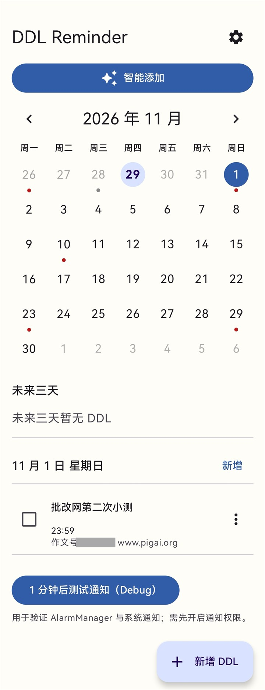
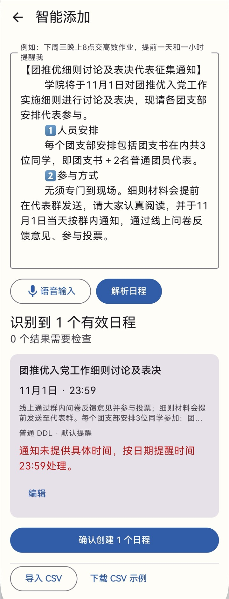
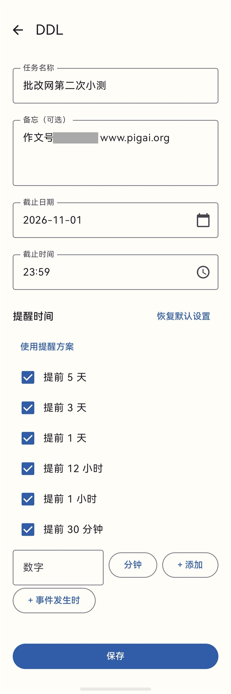
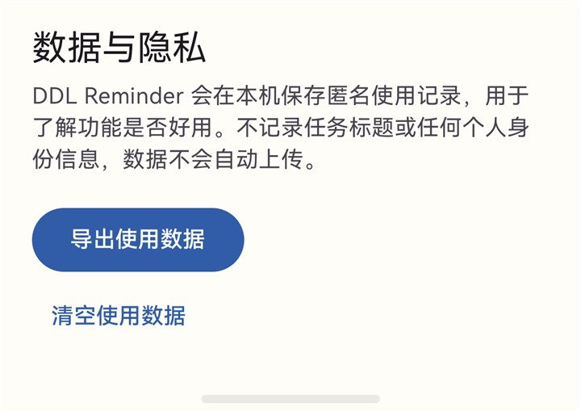

# DDL Reminder

一个本地优先的 Android App，用于记录课程或任务截止时间，并在截止前发送系统通知。项目面向初学 Android、已有 C++ 基础的读者，刻意保持单模块、少依赖、易追踪。当前版本为 V1.2.7（versionCode 12），简化为单一 AI 模型，默认 gpt-6-luna。

[下载 V1.2.7 APK](https://github.com/DONY2333/ddl_reminder/releases/tag/v1.2.7) · [自动构建检查](https://github.com/DONY2333/ddl_reminder/actions/workflows/android.yml) · [问题反馈](https://github.com/DONY2333/ddl_reminder/issues) · [Apache-2.0 许可证](LICENSE)

## 许可证

Copyright 2026 DONY2333。项目代码采用 [Apache License 2.0](LICENSE)，使用与分发时请遵守其中的版权声明、修改说明和许可要求。第三方依赖仍适用各自的许可证。

## 界面预览

<table>
  <tr><th>月历与任务</th><th>智能添加预览</th><th>备忘与独立提醒</th></tr>
  <tr>
    <td valign="top"></td>
    <td valign="top"></td>
    <td valign="top"></td>
  </tr>
</table>

<details>
<summary>数据与隐私设置</summary>



</details>

截图来自用户提供的实机界面，仅用于功能展示；作业编号已遮挡。Debug 测试通知按钮不属于正式版功能。旧双模型诊断截图未作为当前版本展示。

## 下载与安装

从 [GitHub Release](https://github.com/DONY2333/ddl_reminder/releases/tag/v1.2.7) 下载 `DDL_Reminder_v1.2.7_debug.apk`，复制到 Android 8.0（API 26）或更新系统的手机并安装。首次使用按提示授予通知及闹钟权限；不配置 AI 也能手动添加和本地解析。

这是学习与演示用 **Debug / Beta APK**。使用相同签名、相同 applicationId 的旧版可覆盖安装；不同签名无法直接覆盖。卸载会删除本机数据，请先确认备份需求。

## 仓库自动检查

GitHub Actions 在 push、Pull Request 和手动触发时分别运行 `testDebugUnitTest`、`assembleDebug`、`lintDebug`，保留测试报告、lint 报告与本次 CI 的 Debug APK。CI 产物不会覆盖 `releases/` 历史归档；设备通知、真实 AI 服务与系统权限仍需真机验证。

## 公开版本范围

本仓库发布 **V1.2.7 / versionCode 12** 的 Android 客户端，保留该版本及之前实现的功能、测试、版本报告和历史 APK。所有任务与日志保存在本机，AI 为可选的 BYOK（用户自行配置 API）模式；不包含后端、云端部署脚本、云端接入改造或后续部署资料。

解析链路：Local Fast Path → 单一可配置 AI → AI 失败时保守本地 fallback。预览确认后才写入任务；普通设置只有 API 地址、Key、模型。没有配置 AI 时仍可使用手动添加和本地解析。

V1.2.7 已有验证记录：testDebugUnitTest **303 项通过、0 失败、0 跳过**，assembleDebug 通过，lintDebug **0 Error / 6 Warning**；没有连接设备时未执行 connectedDebugAndroidTest 或真机压测。这是 Demo/Beta 基线，不是生产上线或真实模型准确率证明。本次公开整理仅涉及文档、展示图片及 CI，不修改运行时代码、Prompt 或 Room version 5。

版本归档：[DDL_Reminder_v1.2.7_debug.apk](releases/DDL_Reminder_v1.2.7_debug.apk)。SHA-256：`F1C1A732C71D527ED39EC8EC6ACBF3080D80244DD242AF6199DA94B9774DA3F3`。所有历史 APK 保留，不因重新构建而覆盖；重新构建的默认 APK 不保证与历史归档字节一致。

## 功能

- 月历首页，可切换月份；有 DDL 的日期显示圆点。
- 过去日期弱化显示；切换月份时自动选中与今天相同的日号，目标月份没有该日时选择月末。
- 月历下方展示未来 72 小时内未完成的 DDL。
- 点击日期直接查看当天任务，并从该日期快速新增 DDL。
- 新建和编辑任务名称、截止日期、截止时间。
- 首页“智能添加”支持中文自然语言、系统语音识别和 CSV 批量导入，写入前必须预览确认。
- 本地规则支持今天、明天、后天、下周、月底、月日、上午/下午/晚上及常见提醒表达。
- 可选配置兼容 OpenAI Chat Completions 的服务；失败时安全回退到本地规则解析。
- 简单明确单事件优先本地快路径（零 HTTP）；复杂文本使用单一可配置 AI（默认 gpt-6-luna），失败则保守本地 fallback，不再调用第二个模型。不会按句号机械生成日程。
- DDL 支持可选“备忘”，可保存地点、考试形式、时长、题型、材料和特殊要求；新建、编辑可填写或清空。
- 首页选中日期、未来三天和智能添加预览统一显示小号弱色备忘摘要，最多两行、超出省略；完整内容可在编辑时查看，不截断存储。
- 备忘只保存在本机，不进入匿名日志或提醒通知；只有主动解析的本次文字会发送给用户配置的 AI，不读取或上传已有 DDL 的备忘。
- 支持快捷提醒、0～365 天任意自定义提醒，以及“事件发生时”。
- 支持四个内置提醒方案和可增删改的自定义提醒方案。
- 设置页保存全局默认提醒；它只影响之后新建的任务。
- 每个 DDL 独立保存自己的提醒选择，可在编辑页修改或恢复当前全局默认。
- 已经过去的提醒不会注册。
- 完成任务后保留记录，以灰色和删除线展示，并取消剩余提醒。
- 未完成且已到截止时间的任务显示“已逾期”。
- 任务右侧菜单提供删除操作和二次确认。
- 手机重启以及 App 启动时恢复未来提醒。
- Android 13+ 通知权限、Android 12+ 精确闹钟权限提示。
- 高优先级通知带短促震动。
- Debug 版本提供“1 分钟后测试通知”。
- 在本机记录限定范围内的匿名功能使用事件，并支持手动导出 CSV 或清空。

DDL、设置和匿名日志都只保存在本机；Manifest 已禁用 Android 云备份。只有用户主动配置并确认 AI 隐私说明后，本次要求解析的输入文字才会发送到该用户配置的服务。App 不会上传已有 DDL、event_logs、录音、联系人或设备标识，匿名日志也不记录标题、自然语言正文、语音文本或 CSV 内容。

## 技术与项目结构

- Kotlin、Jetpack Compose、Material 3
- Room 本地数据库
- DataStore Preferences 全局设置
- AlarmManager、BroadcastReceiver、Notification
- 简化 MVVM，不使用 Hilt 或多模块

```text
app/src/main/java/com/example/ddlreminder/
├── data/
│   ├── DdlEntity.kt          Room 表结构
│   ├── DdlDao.kt             数据库操作
│   ├── AppDatabase.kt        Room 数据库入口
│   └── DdlRepository.kt      数据与提醒的组合操作
├── settings/
│   ├── ReminderSettingsRepository.kt  DataStore 全局默认提醒
│   ├── ReminderPresetRepository.kt    内置/自定义提醒方案
│   └── AiSettingsRepository.kt        Keystore 加密 AI 配置
├── smartadd/
│   ├── NaturalLanguageParser.kt       可替换解析接口
│   ├── LocalNaturalLanguageParser.kt  离线中文规则解析
│   ├── FastPathDetector.kt            保守分类，不另造解析器
│   ├── TieredNaturalLanguageParser.kt 本地快路径→单一 AI→保守本地回退
│   ├── ParsePerformance.kt            安全耗时诊断
│   ├── ModelSpeedBenchmark.kt         Debug 固定样例主动测速
│   ├── AiNaturalLanguageParser.kt     严格 JSON 校验与 fallback
│   └── ScheduleCsvParser.kt           UTF-8 CSV 解析与逐行校验
├── logging/
│   ├── EventLogEntity.kt     匿名事件表及限定事件名
│   ├── EventLogger.kt        失败隔离、提醒/逾期去重
│   ├── EventCsvExporter.kt   UTF-8 CSV 编码
│   └── CsvExportManager.kt   FileProvider 标准分享
├── reminder/
│   ├── ReminderCalculator.kt 纯 Kotlin 提醒时间计算
│   ├── AndroidAlarmScheduler.kt
│   ├── AlarmReceiver.kt      闹钟触发后校验数据库并通知
│   ├── BootReceiver.kt       开机后恢复提醒
│   └── NotificationHelper.kt
├── ui/
│   ├── calendar/             月历和当天任务列表
│   ├── editor/               新建/编辑页
│   ├── settings/             默认提醒设置页
│   └── theme/
├── DdlReminderApplication.kt 手动组装依赖
└── MainActivity.kt           单 Activity 入口
```

## 如何运行

1. 安装 Android Studio，安装 Android SDK Platform 35 和 JDK 17（Android Studio 自带的 JDK 也可以）。
2. 用 Android Studio 打开本目录，等待 Gradle Sync 完成。
3. 在手机上开启“开发者选项”和“USB 调试”，通过 USB 连接电脑并允许调试。
4. 在 Android Studio 顶部选择手机，点击 Run ▶。
5. 首次启动按页面提示开启通知权限；若希望更准时，再开启“闹钟和提醒”特殊权限。

命令行构建：

```powershell
.\gradlew.bat testDebugUnitTest
.\gradlew.bat assembleDebug
.\gradlew.bat lintDebug
```

生成的 APK：

```text
app/build/outputs/apk/debug/app-debug.apk
releases/DDL_Reminder_v1.2.7_debug.apk
```

每个可安装版本还会按版本号复制到项目根目录的 `releases/`，历史 APK 不覆盖，便于回滚和真机对比。

使用 adb 安装或覆盖安装：

```powershell
adb install -r ".\releases\DDL_Reminder_v1.2.7_debug.apk"
```

也可以把 APK 复制到手机，在文件管理器中打开；系统可能要求允许该文件管理器“安装未知应用”。

## 提醒机制

保存任务后，`ReminderCalculator` 根据该任务自身保存的分钟 offset 计算时间，并过滤已经过去的结果。`AndroidAlarmScheduler` 以“任务 ID + 截止时间 + offsetMinutes”建立唯一 `PendingIntent`，因此自定义提醒也不会互相覆盖。

有精确闹钟权限时使用 `setExactAndAllowWhileIdle()`；没有时降级为 `setAndAllowWhileIdle()`，因此提醒可能延迟。闹钟触发后，`AlarmReceiver` 不直接相信 Intent，而是重新查询 Room，确认任务存在、未完成、未逾期且截止时间未被编辑，才发送高优先级 Notification。

完成、编辑和删除都会按任务旧截止时间和旧 offset 集合取消全部旧 `PendingIntent`。`BOOT_COMPLETED` 后 `BootReceiver` 查询所有未完成、未逾期任务并重新注册；App 每次启动也执行相同同步。

V1.1 使用通知频道 `ddl_reminders_v2`，开启震动并使用短促模式 `0, 180, 120, 240 ms`。Android 8+ 的通知频道一旦创建，震动配置不能由代码原地修改，因此升级版本使用了新的 Channel ID。旧频道可能仍显示在系统设置中，但不会再用于新通知。

## 数据与升级

- Room 数据库当前版本为 5。
- `MIGRATION_1_2` 为旧 DDL 增加 `reminderTypesCsv` 字段。
- `MIGRATION_2_3` 只新增独立 `event_logs` 表及索引，不修改或重建 `ddls`。
- `MIGRATION_3_4` 新增 `reminderOffsetsCsv`，把旧枚举无损映射为分钟 offset；旧列、DDL 和 `event_logs` 均保留。
- `MIGRATION_4_5` 为 DDL 增加可空的 `notes` 字段，不重建表，不修改提醒或日志。
- 从 V1.0 升级时 Room 会依次执行 `1 → 2 → 3 → 4 → 5`，已有任务不会丢失。
- 已有任务自动继承 V1.0 的四个提醒：5 天、3 天、1 天、12 小时。
- migration 使用 `ALTER TABLE`，不会删除或重建旧任务表。
- 全局默认提醒保存在 DataStore，只在新建任务或点击“恢复默认设置”时读取。
- 修改全局默认值不会修改已经创建的 DDL。

## 匿名本地日志与 CSV

V1.1.1 只记录以下事件：

```text
ddl_created, ddl_edited, ddl_completed, ddl_restored, ddl_deleted,
reminder_scheduled, reminder_fired, reminder_clicked, ddl_overdue,
app_opened, three_day_item_clicked
```

`reminder_scheduled` 按任务、截止时间和提醒节点去重，启动同步同一个 Alarm 不会反复写日志。`ddl_overdue` 按任务 ID 只记录一次。日志写入异常会在 `EventLogger` 内部隔离，不会阻止 DDL 保存、删除、完成或通知。

设置页的“数据与隐私”区域可以：

- 使用 `FileProvider + ACTION_SEND` 导出 UTF-8 CSV，不申请存储权限。
- 只清空 `event_logs`，不会删除任何 DDL。
- 用户自行选择文件管理器、微信、QQ、邮箱或网盘等接收方式；App 不会后台上传。

V1.2 新增的智能添加事件仅记录成功/失败、是否使用 AI、事件数量等数字、布尔或枚举信息：

```text
smart_add_opened, natural_language_parse_requested,
natural_language_parse_succeeded, natural_language_parse_failed,
voice_input_started, voice_input_succeeded, voice_input_failed,
csv_import_started, csv_import_previewed, csv_import_completed,
batch_ddl_created, custom_reminder_used, reminder_preset_used
```

这些事件不记录任务标题、原始自然语言、语音识别文本或 CSV 内容。

## 智能解析配置与隐私

设置页的“智能解析”区域只保留 API 地址、API Key、AI 模型三个配置输入框，以及原有隐私确认、保存与连接测试。默认模型为 `gpt-6-luna`，可填写中转实际 Model ID；协议不按模型字符串写分支。V1.2.6 升级时按旧 `fastModel` → 旧 `modelName` → 默认值选择，保留 Base URL、Key 和隐私确认。旧 strongModel 仅保留为兼容数据，不参与正常解析。

App 规范配置首尾空白和 Base URL 外层引号、尾部斜杠，并追加 `/chat/completions`，不会自动增加 `/v1`。API Key 正常路径使用 Android Keystore 支撑的加密本地存储，不写入源码、BuildConfig、资源、日志或 CSV；现有 Keystore 初始化失败分支会退回普通 SharedPreferences，不能承诺异常情况下也加密，请使用可撤销、限额的演示 Key。可测试当前模型的连接/耗时；连接成功不等于日程解析成功。

保存和请求前均清理 Base URL、Key、Model 的首尾空白；Base URL 另外去掉一对包裹整个字符串的单/双引号，不替换内部内容。`https://api.example.com/v1` 和末尾带 `/` 的输入都请求 `https://api.example.com/v1/chat/completions`。

“最近一次 AI 请求”显示状态码、真实耗时、最终请求 Endpoint 和具体异常类（如 `UnknownHostException`、`ConnectException`、`SSLHandshakeException`、`SocketTimeoutException`）。URL 验证失败显示 `URL_INVALID`，请求构建阶段失败显示 `REQUEST_BUILD_FAILED` 并附异常类。计时使用单调时钟；已尝试连接但不足 1ms 的请求按 1ms 展示，未知耗时不伪装成 0ms。诊断不保存 API Key、Authorization、用户输入/响应正文或异常 message。

URL 必须包含 http/https scheme 和非空 host；不接受内嵌凭证、query 或 fragment。请求不自动跟随重定向，防止凭证转发并确保显示的 Endpoint 就是请求地址。请填写最终 API 地址。http URL 虽通过格式校验，仍可能被 Android 明文网络策略拒绝；推荐 https，不全局放开明文流量。

只有勾选隐私确认后才会使用网络 AI。每次请求只包含当前用户主动提交的文字、当前本地时间和统一结构化输出提示。AI 失败或达到原有 30 秒 AI 链路上限后停止网络请求，转保守本地解析并明确提示；外部取消继续传播，不当作 AI 失败回退。所有结果经 Preview 确认才写 Room，原输入保留供修改或重试。

设置页另显示最近一次解析方式（LOCAL / AI / LOCAL_FALLBACK）、AI 模型、HTTP 和 JSON 处理耗时、总耗时、网络重试和失败阶段。HTTP 包含中转和模型等待，不能据此拆出模型真实推理耗时。只在同页同输入同配置且 Preview 存在时复用预览；改输入/离页失效，不保存持久 AI 缓存。

V1.2.7 从普通设置页（包括 Debug 包）隐藏模型速度测试，保留 ModelSpeedBenchmark 代码、取消处理和全部既有测速测试，供后续开发使用。AI 网络临时失败仍同模型最多重试一次，绝不自动切换高级模型。Smart Add Parsing 显示圆形进度动画与“正在识别日程…”，约 1.5 秒后显示“正在理解通知内容…”，失败后恢复操作，保留输入和固定顶栏，无假百分比。

## 测试

V1.2.7 完整回归共 303 项，新增 10 项；原有双模型升级用例按单模型规则更新，既有 Benchmark 测试全部保留。覆盖简单句零 HTTP、复杂通知单模型、失败本地回退、同模型有限重试、旧配置兼容、普通设置页隐藏双模型与 Benchmark，以及加载动画/延迟文案/失败结束。军理通知在模拟 AI 响应的 Parser 和 ViewModel 回归中均保持一个事件、补充说明放入备忘；不等于已验证真实中转模型输出。

V1.2.6 回归共 293 项，新增 28 项，0 失败/错误/跳过；覆盖四次成功、单次/整体超时、HTTP/JSON 失败、协程异常、取消/离页、旧响应隔离、相同模型跳过、真实 HTTP 实现不重试与取消断开连接，以及 Compose 进度/结果/按钮和真实设置页销毁取消。详情见 [测速修复报告](BENCHMARK_V1.2.6.md)。

V1.2.5 回归共 265 项，新增 67 项，0 失败/错误/跳过；`testDebugUnitTest`、`assembleDebug`、`lintDebug` 均通过（lint 0 Error、6 Warning）。FastPath 17 项和模型路由/兼容性 35 项全部通过；实际中转/真机性能仍待验证，详见 [性能报告](PERFORMANCE_V1.2.5.md)。

V1.2.4 的回归测试与发布门槛见 [稳定性报告](STABILITY_V1.2.4.md)。Compose/Robolectric 测试不等于真机键盘、系统 Insets 和真实 AI 服务压测。没有连接设备时，不宣称已执行 `connectedDebugAndroidTest`。

单元测试覆盖：

- 原有四个提醒时间计算。
- 1 小时和 30 分钟提醒计算。
- 关闭提醒节点后不再计算该提醒。
- 已经过期的提醒节点不会注册。
- 修改任务提醒设置时取消旧 Alarm 并保存新选择。
- 距截止不足 5 天时过滤过去提醒。
- 完成后取消提醒。
- 修改截止时间后取消旧提醒并注册新提醒。
- 删除后取消提醒。
- 逾期状态计算。
- 启动/开机恢复时只恢复未完成且未逾期的任务。
- 切换月份选择同日号；日期不存在时选择月末。
- 未来 72 小时筛选和排序。
- 已完成、已逾期任务不会进入未来三天列表。
- 匿名事件内容、完成时间差、提醒和逾期去重。
- 日志失败不影响 DDL 主流程，清空日志不影响 DDL。
- CSV 表头、多事件以及逗号、引号、换行转义。
- Room `MIGRATION_2_3` 保留 V2 任务并创建日志表。
- Room `MIGRATION_3_4` 保留旧任务和日志，并正确迁移六种旧提醒枚举。
- 中文日期/时间、多事件、缺失时间默认值和跨年规则。
- AI 非法 JSON、网络失败 fallback，以及 CSV 多行与逐行错误隔离。
- 自定义 offset、Alarm 唯一身份、批量创建、提醒方案复制语义。
- 备忘创建、编辑、清空、空白归一化和长文本完整保存（含真实 Room/SQLite 读写）。
- `MIGRATION_4_5` 为旧任务补充 null 备忘，保留完成状态和任务数据。
- AI 补充信息保留为单个事件的备忘，JSON null/空白备忘安全处理。
- 创建、编辑、完成、恢复、删除事件不含备忘内容。
- Compose 原生文字布局测试：空备忘无占位，长备忘两行省略且完整数据不变。
- AI 配置清理、URL 归一化与校验、请求构建失败、具体客户端异常、单调计时和诊断隐私（使用模拟连接，不发送外网请求）。

Debug 包可在首页点击“1 分钟后测试通知（Debug）”做真机端到端验证。Release 构建不会显示此入口。

## 版本记录

### v1.2.7

- 简化 AI 设置为 API 地址、API Key、AI 模型，默认 gpt-6-luna，支持任意中转 Model ID。
- 旧 fastModel 优先迁移为当前模型；为空则沿用旧 Model Name，再为空使用默认，凭证和隐私确认不变。
- Local Fast Path → 单一 AI → 保守本地回退，不再自动调用第二模型；保留同模型有限网络重试和原有稳定性保护。
- 普通 UI 隐藏 Benchmark 与双模型诊断；补全约 1.5 秒后的加载提示，保留测速实现和测试。
- Room 仍为 5，无新增 Migration，现有日程解析 Prompt 不变；历史 APK 不覆盖。
- 新增 10 项测试，完整回归 303 项全部通过；testDebugUnitTest、assembleDebug、lintDebug 均通过（lint 0 Error、6 Warning）。无连接设备，未执行 connectedDebugAndroidTest，真实中转仍需真机验证。

### v1.2.6

- 修复 Debug 模型速度测试等待过久：12 次逻辑请求缩减为 4 次，不重试；单次 15 秒、整体 90 秒上限。
- 实时显示 1/4～4/4 进度、逐次结果和当前平均耗时，增加取消按钮；返回、离页、后台与 ViewModel 清理均取消测速。
- 相同模型跳过测试；异常和取消均退出加载，旧响应不能覆盖取消状态；不改变正常智能解析。
- Room 保持 5，无新增 Migration；历史 APK 保留，覆盖安装沿用原有数据。
- 新增 28 项测试，完整回归 293 项通过；Debug 构建与 lint 通过。无连接设备，未执行 connected tests 或真实 API 验证。

### v1.2.5

- 保守 Local Fast Path → 快速模型 → 条件性高级模型兜底；避免无意义双模型请求。
- 兼容旧单模型设置，保留凭证；统一精简 Prompt、30 秒链路超时和一次网络重试上限。
- 增加 HTTP/JSON/总耗时诊断、短期页面去重及 Debug 固定样例串行测速。
- 修正简单句标题的时间前缀、“交论文”标题和下午冒号时间；无效具体时间不得被快路径降为默认时间。
- Room 保持 5，无新增 Migration；保留原有 Insets、导航安全、异常隔离与白屏诊断，不宣称原始白屏根因已彻底解决。
- 新增 67 项测试，总计 265 项通过；Debug 构建及 lint 通过。无连接设备，未执行 connected tests 或真实 API 性能验收。

### v1.2.4

- 拆分 AI 请求成功与日程解析成功；最近一次诊断在 Smart Add 与设置页之间共享，标明失败阶段、具体异常类和请求次数。
- 增加有界 JSON 提取、可选字段默认值和逐事件隔离；暂时性 HTTP/连接错误最多重试一次，不重试 JSON/schema 错误。
- Smart Add 使用显式状态、离页取消和请求代次校验；JSON/CSV/批量写入转移至合适 dispatcher，异常后保留输入并恢复可操作页面。
- Smart Add 改为独立 Scaffold + 固定 TopAppBar + 单一 LazyColumn，消费一次 innerPadding，并处理 IME。
- 保护 DataStore/Room/协程异常、重复返回和空导航栈；Debug 增加有界本地诊断，不记录用户正文或凭证。
- Room 仍为 5，DDL 数据结构和 AI Prompt 文件不变，无新增 Migration。
- 回归测试 198 项全部通过（新增 71 项）；Debug 构建和 lint 通过。另提供 3 项设备测试，无连接设备尚未执行。详细证据和真机清单见 [稳定性报告](STABILITY_V1.2.4.md)。
- **未捕获原始偶发白屏根因；新增防护与诊断不代表已彻底修复，需完成真机压测后再评估上线。**

### v1.2.3

- 增强 AI 客户端网络诊断：展示实际 Endpoint、具体异常类、URL/请求构建失败阶段及真实耗时。
- 统一清理配置首尾空白和 Base URL 外层引号，补齐 URL 校验；Key 输入框隐藏显示。
- 诊断不含凭证、请求/响应正文和异常 message；保留既有 AI fallback 行为。
- 数据库结构不变，Room 仍为 5，无新增 Migration。

### v1.2.2

- 统一产品名称为“备忘”，补齐首页、未来三天和智能预览中的两行弱色摘要，空内容不占位。
- 保留手动创建、修改、清空和完整内容存储能力，不改变通知正文。
- 修复 AI JSON null 备忘被当成文字的问题，补充保存、AI 抽取、日志隐私与 Compose 展示测试。
- 复用已有 `notes: String?`，Room 仍为 5，无新 Migration；旧版继续使用已有显式迁移链，旧任务备忘为 null。

### v1.2.1

- 修复长通知按句号拆成多个垃圾日程的问题，同一事件的形式、地点、时长和题型合并为 notes。
- AI 配置完整时改为 AI First，失败后明确提示并使用保守本地 fallback。
- 拆分 `AiApiClient`、Prompt、JSON 校验和 Parser，兼容第三方 Chat Completions 中转 API。
- 区分具体时间、上午/下午等时间段和纯日期；只有时间段时必须由用户确认。
- Preview 默认改为紧凑摘要，点击编辑后才展开日期、时间、提醒和备注。
- Room 升级到 5，通过 `MIGRATION_4_5` 增加 DDL notes。

### v1.2.0

- 新增自然语言批量创建、系统语音输入和 CSV 导入，统一经过可编辑预览确认。
- 新增本地规则解析器及可替换 AI parser；AI 输出执行严格 JSON 与字段校验，失败回退本地解析。
- 提醒数据升级为通用 `offsetMinutes`，支持自定义提醒和事件发生时提醒。
- 新增内置与自定义提醒方案；方案是模板，不会动态修改历史 DDL。
- Room 升级到 4，并通过 `MIGRATION_3_4` 保留旧 DDL、旧提醒和匿名日志。
- 补充 AI 隐私说明：只发送用户本次主动解析的文字，任何用户内容均不写入匿名日志。

### v1.1.2

- 增加版本化 APK 交付规范。
- 在 `releases/` 中保留历史安装包，避免覆盖旧版本。
- 明确每次交付均需分别通过单元测试、Debug 构建与 lint 检查。

### v1.1.1

- 增加匿名本地行为日志。
- 支持通过系统分享面板导出 CSV，并可单独清空匿名日志。

## 当前状态与已知限制

- 用户已确认此前白屏问题解决；旧版稳定性报告保留当时的排查记录，不代表当前问题状态。本次文档整理未新增真机复测或推断根因；本地诊断与错误恢复继续保留，若再发生异常可抓取 Logcat。
- Keystore 初始化失败时现有实现会退到普通 SharedPreferences；本公开版本不构成生产级凭证保护承诺。不要把真实 API Key 或签名私钥提交到仓库。
- Android 厂商省电策略可能延迟或限制后台提醒。
- 用户对 App 执行“强行停止”后，系统通常不会投递闹钟，直到再次手动打开 App。
- 横幅/悬浮通知由系统通知频道和用户设置决定，App 无法强制展示。
- 用户清除 App 数据或卸载后，本地 DDL 会丢失。
- MVP 只响应 `BOOT_COMPLETED`；系统时间、时区变化和应用升级后的主动同步留待后续。
- 本地规则解析聚焦常见中文表达，复杂语句仍需用户在预览页确认或修改。
- 系统语音识别能力取决于手机是否安装可用的语音服务。
- AI 服务由用户自行配置，其可用性、隐私条款和费用由对应服务商决定。
- 当前不支持登录、云同步、日程组或小组件。

## 后续迭代方向

- 响应 `TIME_SET`、`TIMEZONE_CHANGED`、`MY_PACKAGE_REPLACED`。
- 自定义提醒规则和课程分类。
- 搜索、筛选、历史任务归档。
- Room Migration 和数据库导出/本地备份。
- 扩展 Compose UI 覆盖与真机仪器测试。
